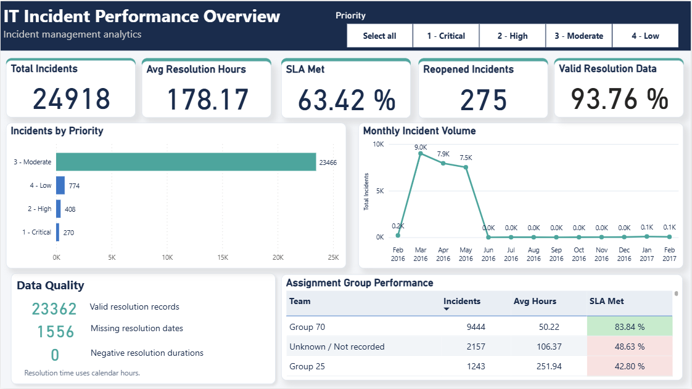

# IT Incident Management Analytics

A SQL Server and Power BI project analyzing **141,712 event records across 24,918 unique IT incidents**.

The project transforms incident histories into a validated incident-level dataset and an interactive report covering incident volume, resolution time, recorded SLA compliance, reopening, and data completeness.



## Overview

An incident can appear multiple times in an event log as its status and other attributes change. Treating every event as a separate incident would inflate reporting metrics.

This project preserves the raw event history, cleans selected fields, and identifies the latest record for each incident before calculating operational KPIs.

## Key Results

Results below represent the complete reporting dataset without priority filters.

| Metric | Result |
|---|---:|
| Source event records | 141,712 |
| Unique incidents | 24,918 |
| Average resolution time | 178.17 calendar hours |
| Recorded SLA compliance | 63.42% |
| Incidents reopened at least once | 275 |
| Incidents with valid resolution durations | 23,362 |
| Incidents missing an opening or resolution date | 1,556 |
| Valid resolution data coverage | 93.76% |

## Tools

- **SQL Server:** data storage, cleaning, transformation, and validation
- **SQL Server Management Studio:** SQL development and execution
- **Power Query:** data import and type verification
- **DAX:** measures and calculated columns
- **Power BI Desktop:** interactive reporting and visualization

## Business Questions

- Which priorities account for the highest incident volume?
- How does incident volume vary by opening month?
- What is the average elapsed time from opening to resolution?
- What proportion of incidents met the SLA recorded in the source?
- How many incidents were reopened?
- How do reported metrics differ across assignment groups?
- How complete are the dates required to calculate resolution time?

## Data Preparation

The source CSV contains **36 columns**. Each row represents an incident event or snapshot, and multiple rows can share the same incident number.

The reporting dataset contains **one latest record per incident**.

### SQL Workflow

```text
Source CSV
    ↓
incident_events_raw
    ↓
vw_incident_events_clean
    ↓
vw_incidents_latest
    ↓
vw_incidents_reporting
    ↓
Power BI
```

| SQL Object | Purpose |
|---|---|
| `dbo.incident_events_raw` | Preserve imported source values |
| `dbo.vw_incident_events_clean` | Normalize missing values and convert selected fields to appropriate types |
| `dbo.vw_incidents_latest` | Retain the latest event for each incident |
| `dbo.vw_incidents_reporting` | Add resolution duration and data quality classifications |

### Cleaning and Transformation

- Trimmed leading and trailing spaces.
- Converted `?` and empty strings to `NULL`.
- Parsed dates using day/month/year conventions.
- Converted modification and reopening counters to integers.
- Mapped the source SLA flag to `1`, `0`, or `NULL`.
- Preserved missing resolution durations rather than replacing them with zero.
- Displayed missing assignment groups as `Unknown / Not recorded`.

### Latest-Event Selection

Some incidents had multiple events sharing the latest update timestamp. The modification counter was used as a secondary ordering field:

```sql
ROW_NUMBER() OVER (
    PARTITION BY incident_number
    ORDER BY
        updated_at DESC,
        modification_count DESC
) AS row_num
```

Retaining `row_num = 1` produces one record per incident. A separate validation query confirmed that no latest-event ties remained under this ordering in the current dataset.

### Resolution Duration

```sql
CASE
    WHEN resolved_at >= opened_at
    THEN DATEDIFF_BIG(
        SECOND, opened_at, resolved_at
    ) / 3600.0
END AS resolution_hours
```

This calculation measures elapsed calendar hours. Missing dates and negative durations are excluded from the reported average.

## Dashboard Features

The single-page report includes:

- Five KPI cards
- Incident counts by priority
- Monthly incident volume
- Assignment group performance table
- Resolution data quality summary
- Interactive priority slicer

GitHub displays a static preview. Download the `.pbix` file and open it in Power BI Desktop to explore the interactive report.

## Findings

### Priority Distribution

| Latest Recorded Priority | Incidents |
|---|---:|
| 3 - Moderate | 23,466 |
| 4 - Low | 774 |
| 2 - High | 408 |
| 1 - Critical | 270 |
| **Total** | **24,918** |

Moderate-priority incidents account for the largest share of the dataset.

### Recorded SLA Compliance

The source indicates that **15,803 of 24,918 incidents** met SLA, giving a recorded compliance rate of **63.42%**.

This uses the supplied SLA flag rather than an independently calculated service threshold.

### Resolution Data Coverage

Valid resolution durations are available for **23,362 incidents**. The remaining **1,556 incidents** lack an opening or resolution date and are excluded from the average.

No negative resolution durations were found.

### Assignment Group Completeness

The latest assignment group is unrecorded for **2,157 incidents**. These incidents remain included in reporting under `Unknown / Not recorded`.

### Monthly Volume

Incident volume is concentrated in the early months shown in the report. The decline after May 2016 requires verification of source coverage before it can be interpreted as an operational improvement.

## Metric Definitions

| Metric | Definition |
|---|---|
| Total Incidents | Number of rows in the one-row-per-incident reporting dataset |
| Avg Resolution Hours | Mean valid calendar hours between opening and resolution |
| SLA Met % | Incidents with `sla_met = 1` divided by incidents with a known SLA flag |
| Reopened Incidents | Number of incidents with `reopen_count > 0` |
| Valid Resolution Data | Incidents with valid resolution durations divided by total incidents |
| Monthly Incident Volume | Incident count grouped by opening month |

### Core DAX Measures

Each measure is defined separately in the `Incidents` table.

```dax
Total Incidents =
COUNTROWS(Incidents)
```

```dax
Avg Resolution Hours =
AVERAGE(Incidents[resolution_hours])
```

```dax
SLA Met % =
DIVIDE(
    CALCULATE(
        COUNTROWS(Incidents),
        Incidents[sla_met] = 1
    ),
    COUNT(Incidents[sla_met])
)
```

```dax
Reopened Incidents =
CALCULATE(
    COUNTROWS(Incidents),
    Incidents[reopen_count] > 0
)
```

```dax
Resolution Data Completeness % =
DIVIDE(
    COUNT(Incidents[resolution_hours]),
    [Total Incidents]
)
```

Measures respond to the current filter context. Percentage measures are displayed with two decimal places.

## Validation

| Check | Outcome |
|---|---|
| Raw and cleaned event counts | Reconciled at 141,712 |
| Unique incident count | Reconciled at 24,918 |
| Missing cleaned incident identifiers | 0 |
| Unconvertible nonmissing values in the three date fields checked | 0 |
| Latest-event ties after timestamp and counter ordering | 0 |
| Rows in the latest-incident dataset | One per incident |
| Valid resolution durations | 23,362 |
| Incidents missing required dates | 1,556 |
| Negative resolution durations | 0 |
| Missing or negative reopening counters in latest records | 0 |
| Power BI headline metrics | Matched SQL results |
| Priority slicer interactions | Tested |

Resolution coverage reconciles to the total incident count:

```text
23,362 valid + 1,556 missing + 0 negative = 24,918 incidents
```

## Interpretation Notes

- **SLA compliance is source-reported.** SLA thresholds, business calendars, and pause rules were not independently reconstructed.
- **Resolution time uses calendar hours**, not business hours, first-response time, or staff working time.
- **The average excludes missing or invalid durations.**
- **Resolution data coverage is not an overall data accuracy score.**
- **Reopened incidents counts tickets, not total reopening events.**
- **Priority and assignment group reflect the latest incident record.**
- **Assignment group comparisons are descriptive.** They do not control for incident complexity or attribute every historical action to the team that performed it.
- **Monthly incident volume is not backlog.**
- **Conditional formatting thresholds are visual presentation rules**, not approved organizational performance targets.

## Repository Structure

```text
IT-Incident-Analytics/
├── README.md
├── sql/
│   ├── 01_data_quality_checks.sql
│   ├── 02_clean_events.sql
│   ├── 03_latest_incidents.sql
│   ├── 04_resolution_checks.sql
│   ├── 05_reporting_view.sql
│   └── 06_kpi_checks.sql
├── powerbi/
│   └── IT_Incident_Analytics.pbix
└── images/
    └── dashboard.png
```

## Running the Project

### Requirements

- SQL Server 2017 or later
- SQL Server Management Studio
- Power BI Desktop
- The matching `incident_event_log.csv` source file

### Steps

1. Create a database named `IT_Incident_Analytics`.
2. Import the CSV as `dbo.incident_events_raw`, preserving the original column names.
3. Use text columns with nulls allowed for the raw import. Do not assign a primary key to the incident number because it repeats across events.
4. Execute the SQL scripts in numerical order using their final saved versions.
5. Open `powerbi/IT_Incident_Analytics.pbix`.
6. Update the SQL Server connection to your local instance and the `IT_Incident_Analytics` database.
7. Refresh the report from `dbo.vw_incidents_reporting` using Import mode.
8. Clear priority filters and compare the headline metrics with the results above.

The SQL Server service must be running and accessible for refresh. Import mode reflects the most recent successful data refresh.

## Data Availability

The raw dataset is not included in this repository. Its exact source citation and applicable usage terms have not yet been verified.

The reported results describe the local file used in this analysis. Reproducing them requires the matching source dataset.
